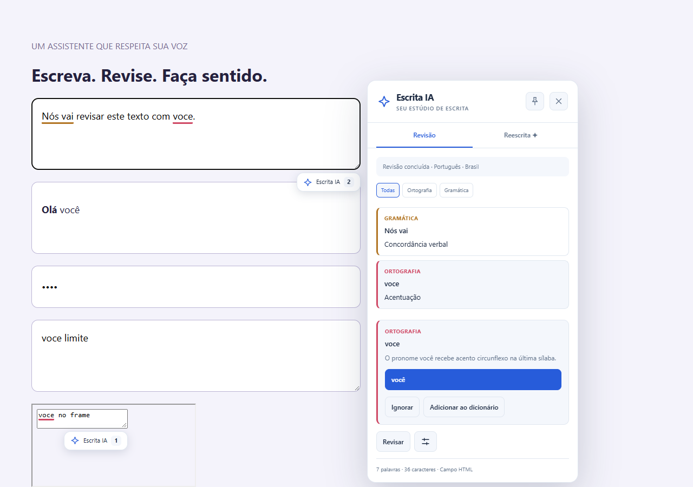
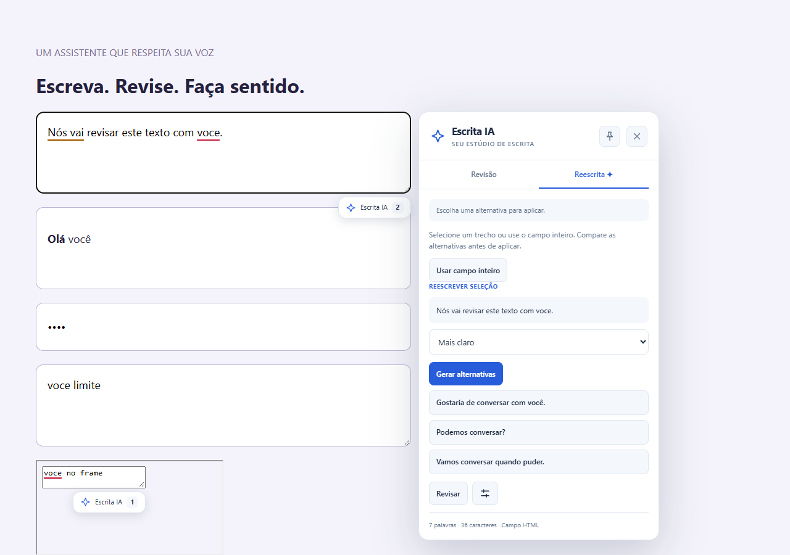
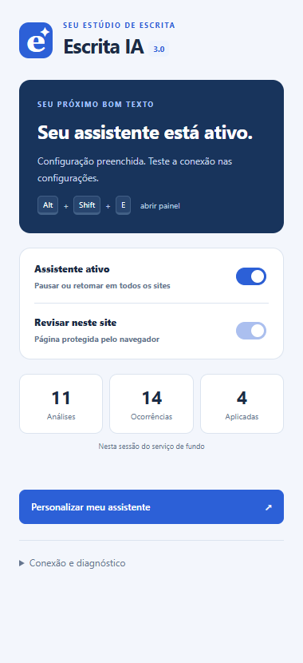
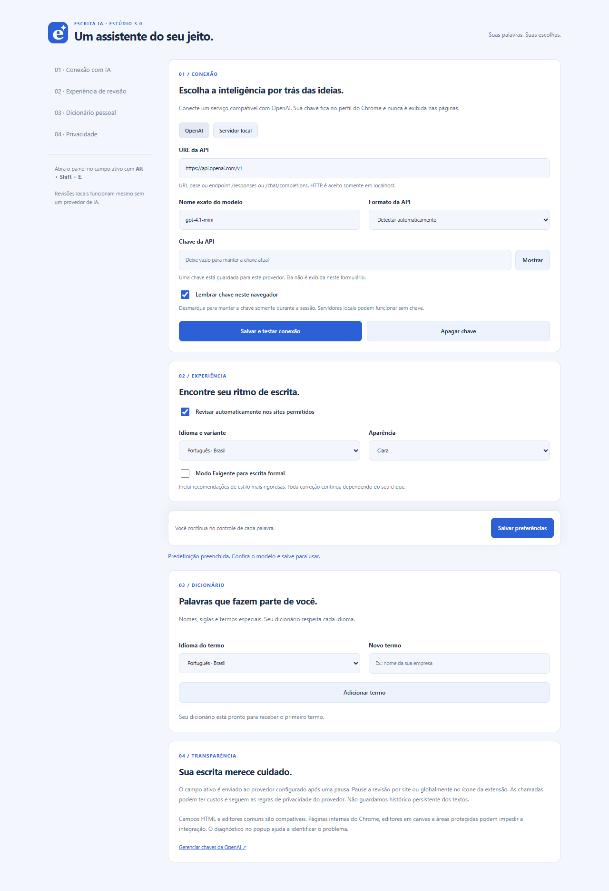
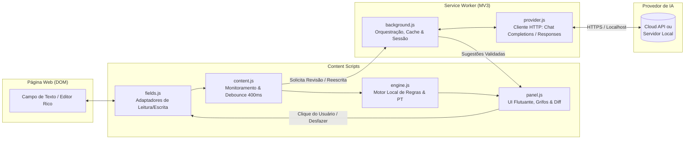

<div align="center">

# ✍️ Escrita IA

### Assistente Híbrido de Revisão Gramatical, Estilo e Reescrita Inteligente para Google Chrome

*Revise ortografia, gramática, pontuação, tipografia, estilo e tom diretamente em qualquer campo de texto da web — combinando um motor local ultrarrápido com o poder do seu próprio modelo de IA (nuvem ou local).*

[[https://img.shields.io/github/actions/workflow/status/Junio243/escrita-ia/ci.yml?style=for-the-badge&logo=githubactions&logoColor=white&label=CI%20%2F%20Testes]](https://github.com/Junio243/escrita-ia/actions/workflows/ci.yml)
[https://img.shields.io/badge/Vers%C3%A3o-3.2.0-2563EB?style=for-the-badge&logo=semanticrelease&logoColor=white]
[https://img.shields.io/badge/Chrome-Manifest%20V3-4285F4?style=for-the-badge&logo=googlechrome&logoColor=white]
[https://img.shields.io/badge/Node.js-22%20LTS-339933?style=for-the-badge&logo=nodedotjs&logoColor=white]
[https://img.shields.io/badge/Idiomas-34%20(36%20Variantes]-8B5CF6?style=for-the-badge)
[https://img.shields.io/badge/Licen%C3%A7a-MIT-10B981?style=for-the-badge]

<br />

[[https://img.shields.io/badge/%F0%9F%8C%90_Testar_Est%C3%BAdio_de_Escrita_(Demo]-111827?style=for-the-badge)](https://Junio243.github.io/escrita-ia/)
[[https://img.shields.io/badge/%F0%9F%93%A6_Baixar_Extens%C3%A3o_(.ZIP]-2563EB?style=for-the-badge)](https://github.com/Junio243/escrita-ia/archive/refs/heads/main.zip)
[[https://img.shields.io/badge/%F0%9F%93%96_Manual_(LEIA--ME]-374151?style=for-the-badge)](LEIA-ME.md)
[[https://img.shields.io/badge/%E2%9C%85_Valida%C3%A7%C3%A3o_&_Testes-059669?style=for-the-badge]](VALIDACAO.md)

<br />

[docs/screenshots/extension.png]

*Grifos discretos durante a digitação, sugestões contextuais sob demanda e zero alterações aplicadas sem o seu clique.*

</div>

---

## 🧭 Índice de Navegação

1. [Sobre o Projeto & Arquitetura Híbrida](#-sobre-o-projeto--arquitetura-híbrida)
2. [Novidades da Geração 3.x (v3.0 a v3.2.0)](#-novidades-da-geração-3x-v30-a-v320)
3. [Galeria Visual da Extensão & Estúdio Web](#-galeria-visual-da-extensão--estúdio-web)
4. [Engenharia de Revisão & Os 9 Modos de Reescrita](#-engenharia-de-revisão--os-9-modos-de-reescrita)
5. [Ecossistema de Compatibilidade (Sites & Editores)](#-ecossistema-de-compatibilidade-sites--editores)
6. [Provedores de IA Suportados (Cloud & Local)](#-provedores-de-ia-suportados-cloud--local)
7. [Arquitetura Interna & Fluxo de Dados](#-arquitetura-interna--fluxo-de-dados)
8. [Guia de Instalação e Atualização](#-guia-de-instalação-e-atualização)
9. [Atalhos de Teclado e Produtividade](#-atalhos-de-teclado-e-produtividade)
10. [Desenvolvimento, Testes Automatizados e CI/CD](#-desenvolvimento-testes-automatizados-e-cicd)
11. [Privacidade, Segurança e Isolamento](#-privacidade-segurança-e-isolamento)

---

## 💡 Sobre o Projeto & Arquitetura Híbrida

A **Escrita IA** foi projetada para resolver um problema comum das ferramentas de revisão modernas: a dependência exclusiva de servidores proprietários lentos ou invasivos. Para isso, a extensão opera com uma **arquitetura de duplo motor**:

- Análise automática após 400 ms sem digitação.
- Correções de ortografia, gramática, pontuação e tipografia (incluindo espaço antes da pontuação).
- Sugestões de estilo, tom, redundância e concisão.
- 9 estilos de reescrita: *Mais claro*, *Mais conciso*, *Mais formal*, *Mais fluido*, *Mais persuasivo*, *Mais amigável*, *Direto ao ponto*, *Acadêmico e técnico* e *Mais criativo*.
- Aplicação de cada sugestão com um clique, botão **Copiar** texto, **Limpar espaços** e opção de desfazer.
- Atalho `Alt+Shift+E` (ou botão direto no popup) para abrir/fechar o painel no campo ativo.
- Estatísticas da sessão (análises, ocorrências, sugestões aplicadas) e controle rápido do **Modo Exigente** no popup.
- Revisão local sem IA para palavras e espaços duplicados e espaço antes de pontuação; com **Português · Brasil** ou **Português · Portugal** selecionado, também verifica acentuação ampliada, grafia (`concerteza`, `derepente`, `porisso`, `apartir`), verbos impessoais (`fazer`/`haver`), crase e pleonasmos.
- Banco local de correções offline: abreviaturas e formas informais (`vc`, `vcs`, `tmb`, `pq`, `qdo`, `pra`, `pro`, `hj`, `amn`, `msg`, `obrigad`, `blz`, `sds`, `bjs`, `tdb`, `valeu`, `flw`) são sugeridas na revisão local sem chamada à IA.
- Dicionário pessoal separado por idioma, com busca em tempo real, contador de termos e importação/exportação em JSON.
- Gerenciamento de sites pausados diretamente na página de Configurações e predefinições para **Google AI Studio**, **OpenAI**, **OpenRouter**, **Groq**, **Ollama** e **LM Studio**.
- Modo Exigente para revisão estilística mais rigorosa.
- Contadores de palavras, caracteres, frases, tempo estimado de leitura e legibilidade.
- Temas claro e escuro.
- 36 variantes em 34 idiomas.
- Adaptadores para campos (`textarea`, `input[type=text]`, `input[type=search]`, `contenteditable`) e editores usados por ChatGPT, Instagram, Facebook, LinkedIn, X, Gmail, WhatsApp Web, Notion, GitHub, Claude, Gemini, Slack e Discord.

| Característica | ⚡ Motor Local (`engine.js`) | 🧠 Motor de IA (`provider.js`) |
| :--- | :--- | :--- |
| **Conectividade** | 100% Offline (execução instantânea no navegador) | Online (Cloud APIs) ou Localhost (`Ollama` / `LM Studio`) |
| **Tempo de Resposta** | Imediato (após *debounce* de `400 ms` sem digitar) | Sob demanda / Assíncrono com cancelamento automático |
| **Escopo de Atuação** | Espaços/palavras duplicadas, pontuação, acentuação, crase, pleonasmos, verbos impessoais e grafias comuns | Gramática complexa, coesão, clareza, tom, reescrita estilística em 9 modos e semântica contextual |
| **Aplicação no Texto** | Individual ou em lote reversível (**Aplicar correções locais**) | Individual com pré-visualização e botão **Desfazer** |
| **Custo & Chave** | Gratuito, sem necessidade de configuração | *Bring Your Own Key* (BYOK) ou gratuito via modelos locais |

---

## 🚀 Novidades da Geração 3.x (v3.0 a v3.2.0)

### Destaques da Versão `3.2.0` (Atual)
- 🎨 **Identidade Visual Renovada:** Novo `logo.svg` vetorial e ícones PNG renderizados em alta definição.
- 🔄 **9 Estilos de Reescrita:** Expansão completa dos modos de transformação textual para até **6.000 caracteres** (seleção ou campo inteiro).
- 📊 **Métricas Avançadas (`textStats`):** Contagem em tempo real de palavras, caracteres, frases, tempo estimado de leitura e índice de legibilidade.
- 🧹 **Higienização Instantânea (`cleanText`):** Limpeza rápida de espaços excedentes e ruídos de formatação com suporte a desfazer.
- 🇧🇷 **Regras Nativas Expandidas (PT-BR & PT-PT):** Detecção local de acentuação ampliada, erros clássicos de grafia (`concerteza`, `derepente`, `porisso`, `apartir`), regência de verbos impessoais (`fazer`/`haver`), uso de crase e pleonasmos viciosos.
- 📖 **Dicionário Pessoal Avançado:** Separado por idioma, com busca em tempo real, contador de vocábulos e importação/exportação em formato `JSON`.
- 🛡️ **Gestão de Domínios & Popup Ágil:** Controle de sites pausados diretamente nas Configurações, atalhos rápidos no Popup e chaveamento imediato do **Modo Exigente**.

<details>
<summary><strong>📌 Ver melhorias consolidadas das versões 3.0.0 e 3.0.1 (Clique para expandir)</strong></summary>
<br />

- **Painel Unificado 3.0:** Abas dedicadas para **Revisão** e **Reescrita**, filtros rápidos por categoria de erro, indicador flutuante compacto (arrastável com memória de posição) e opção de fixar o painel no canto da tela.
- **Prevenção de Abertura Acidental:** Os grifos no texto abrem sugestões exclusivamente por clique (passar o mouse não dispara mais o painel). A tecla `Esc` encerra a revisão imediatamente.
- **Lote Reversível:** A função **Aplicar correções locais** consolida múltiplos ajustes não sobrepostos em uma única operação reversível.
- **Correção para Google AI Studio (3.0.1):** Seleção automática do transporte *Chat Completions* para o domínio `generativelanguage.googleapis.com`, eliminando chamadas indevidas à *Responses API* e diferenciando com precisão falhas de modelo inexistente, chave inválida, permissão ou limite de cota (*rate limit*).
</details>

---

## 🖼️ Galeria Visual da Extensão & Estúdio Web

### Extensão Instalada no Google Chrome

<table>
  <tr>
    <td align="center" width="50%">
      <br />
      <strong>Painel de Revisão & Grifos</strong><br />
      <sub>Filtros por categoria, sugestões em um clique e correções locais em lote</sub>
    </td>
    <td align="center" width="50%">
      <br />
      <strong>Aba de Reescrita (9 Modos)</strong><br />
      <sub>Transformação de trechos selecionados ou do campo inteiro (até 6.000 caracteres)</sub>
    </td>
  </tr>
  <tr>
    <td align="center" width="50%">
      <br />
      <strong>Popup de Controle Rápido</strong><br />
      <sub>Pausa global, pausa por domínio, Modo Exigente e estatísticas da sessão</sub>
    </td>
    <td align="center" width="50%">
      <br />
      <strong>Central de Configurações</strong><br />
      <sub>Predefinições de provedores, teste de conexão real, dicionário JSON e domínios</sub>
    </td>
  </tr>
</table>

### 🌐 Estúdio de Escrita (Demonstração Interativa no GitHub Pages)

Experimente o motor local e a experiência de interface sem instalar nada acessando a **[Demonstração Pública Interativa](https://Junio243.github.io/escrita-ia/)**.

- **Exemplos Prontos:** Modelos rápidos de *Ideia*, *E-mail*, *Trabalho* e *Redes Sociais* (com recuperação do rascunho anterior via **Desfazer**).
- **Foco & Ergonomia:** Modo Foco (saída com `Esc`), alternância entre temas Claro e Escuro (salvo localmente) e navegação completa via teclado.
- **Inspeção Direta:** Botão **Ver no texto** para localizar ocorrências, filtros de palavras repetidas/espaços duplicados e higienização imediata.
- **Referência Visual:** Inspirado na organização limpa do [LanguageTool](https://languagetool.org/pt-BR), construído 100% com código, identidade e motor de regras próprios da Escrita IA.

[[docs/screenshots/demo.png]](https://Junio243.github.io/escrita-ia/)

<div align="center">
  <a href="docs/screenshots/demo-dark.png">🌙 <strong>Visualizar Estúdio no Tema Escuro</strong></a> &nbsp;·&nbsp;
  <a href="docs/screenshots/demo-mobile.png">📱 <strong>Visualizar Layout Responsivo (Mobile)</strong></a>
</div>

---

## 🎯 Engenharia de Revisão & Os 9 Modos de Reescrita

### Os 9 Estilos de Reescrita por IA

| # | Estilo de Reescrita | Objetivo Principal | Melhor Aplicação |
| :-: | :--- | :--- | :--- |
| **1** | **Mais claro** | Elimina ambiguidades e simplifica construções truncadas | Explicações, tutoriais e comunicados internos |
| **2** | **Mais conciso** | Corta redundâncias e reduz o texto mantendo 100% da informação | Resumos, mensagens rápidas e limites de caracteres |
| **3** | **Mais formal** | Eleva o vocabulário e adota registro culto e impessoal | E-mails corporativos, ofícios e documentos jurídicos |
| **4** | **Mais fluido** | Melhora o ritmo, as transições entre frases e a cadência de leitura | Artigos, posts de blog e narrativas longas |
| **5** | **Mais persuasivo** | Destaca benefícios, fortalece argumentos e incentiva ação | Propostas comerciais, vendas e landing pages |
| **6** | **Mais amigável** | Torna o tom acolhedor, empático e próximo do leitor | Atendimento ao cliente, onboarding e comunidades |
| **7** | **Direto ao ponto** | Vai direto à conclusão ou pedido principal sem rodeios | Slack, Discord, WhatsApp e cobranças objetivas |
| **8** | **Acadêmico e técnico** | Prioriza precisão terminológica, rigor metodológico e sobriedade | Artigos científicos, relatórios de engenharia e PRs |
| **9** | **Mais criativo** | Explora metáforas, vocabulário expressivo e ângulos originais | Redes sociais, campanhas, roteiros e brainstorming |

---

## 🌍 Ecossistema de Compatibilidade (Sites & Editores)

A extensão suporta **36 variantes linguísticas em 34 idiomas** e conta com adaptadores especializados (`fields.js`) tanto para controles HTML padrão (`textarea`, `input[type=text]`, `input[type=search]`) quanto para editores de texto rico baseados em `contenteditable`:

<div align="center">

[https://img.shields.io/badge/ChatGPT-10A37F?style=flat-square&logo=openai&logoColor=white]
[https://img.shields.io/badge/Claude-D97757?style=flat-square&logo=anthropic&logoColor=white]
[https://img.shields.io/badge/Gemini-4285F4?style=flat-square&logo=googlegemini&logoColor=white]
[https://img.shields.io/badge/Notion-000000?style=flat-square&logo=notion&logoColor=white]
[https://img.shields.io/badge/GitHub-181717?style=flat-square&logo=github&logoColor=white]
[https://img.shields.io/badge/Gmail-EA4335?style=flat-square&logo=gmail&logoColor=white]
[https://img.shields.io/badge/WhatsApp_Web-25D366?style=flat-square&logo=whatsapp&logoColor=white]
[https://img.shields.io/badge/LinkedIn-0A66C2?style=flat-square&logo=linkedin&logoColor=white]
[https://img.shields.io/badge/Slack-4A154B?style=flat-square&logo=slack&logoColor=white]
[https://img.shields.io/badge/Discord-5865F2?style=flat-square&logo=discord&logoColor=white]
[https://img.shields.io/badge/X_(Twitter]-000000?style=flat-square&logo=x&logoColor=white)
[https://img.shields.io/badge/Instagram-E4405F?style=flat-square&logo=instagram&logoColor=white]
[https://img.shields.io/badge/Facebook-1877F2?style=flat-square&logo=facebook&logoColor=white]

</div>

> ⚠️ **Limitações Conhecidas do Navegador:** Por restrições de segurança do próprio Chromium, páginas internas (`chrome://*`), a Chrome Web Store, editores renderizados em `<canvas>` fechado (como o Google Docs padrão) e iframes isolados de domínio cruzado não permitem injeção de scripts.

---

## 🤖 Provedores de IA Suportados (Cloud & Local)

A **Escrita IA** é agnóstica de fornecedor e compatível com qualquer serviço que siga o contrato da **OpenAI API** (*Chat Completions* ou *Responses API*). Quando um formato de transporte funciona no teste, a extensão passa a priorizá-lo automaticamente para reduzir latência.

| Provedor | URL Base Predefinida | Transporte Recomendado | Exige Chave? | Exemplo de Modelo |
| :--- | :--- | :--- | :---: | :--- |
| **Google AI Studio (Gemini)** | `https://generativelanguage.googleapis.com/v1beta/openai/` | `Chat Completions` (Auto) | ✅ Sim | `gemini-2.5-flash` / `gemini-2.0-flash` |
| **OpenAI** | `https://api.openai.com/v1/` | `Responses` ou `Chat Completions` | ✅ Sim | `gpt-4o-mini` / `gpt-4.1-mini` |
| **Groq** | `https://api.groq.com/openai/v1/` | `Chat Completions` | ✅ Sim | `llama-3.3-70b-versatile` |
| **OpenRouter** | `https://openrouter.ai/api/v1/` | `Chat Completions` | ✅ Sim | `anthropic/claude-3.5-haiku` |
| **Ollama (Local)** | `http://localhost:11434/v1/` | `Chat Completions` | ❌ Não | `qwen2.5:7b` / `llama3.2` |
| **LM Studio (Local)** | `http://localhost:1234/v1/` | `Chat Completions` | ❌ Não | *Modelo carregado no servidor* |

<details>
<summary><strong>🔧 Como configurar o Google AI Studio (Gemini) passo a passo</strong></summary>
<br />

1. Abra as **Configurações** da extensão e clique no botão de predefinição **Google AI Studio**.
2. A URL `https://generativelanguage.googleapis.com/v1beta/openai/` e o formato **Chat Completions** serão preenchidos automaticamente.
3. Insira sua chave gerada no Google AI Studio.
4. No campo **Modelo**, digite o identificador exato do modelo Gemini habilitado na sua conta (nunca utilize nomes `gpt-*` neste provedor).
5. Clique em **Salvar e testar conexão** e aguarde a confirmação de resposta válida do modelo. Consulte a [documentação oficial de compatibilidade OpenAI do Gemini](https://ai.google.dev/gemini-api/docs/openai).
</details>

<details>
<summary><strong>💻 Como usar 100% Offline com Ollama ou LM Studio</strong></summary>
<br />

1. Inicie seu servidor local (`ollama serve` em `localhost:11434` ou o servidor local do LM Studio em `localhost:1234`).
2. Certifique-se de que o servidor local permite requisições da origem da extensão (`CORS`).
3. Nas configurações da extensão, selecione a predefinição **Ollama** ou **LM Studio** (endereços `localhost`, `127.0.0.1` e `[::1]` dispensam chave de API).
4. Informe o nome exato do modelo instalado localmente e clique em **Salvar e testar conexão**.
</details>

---

## 🏗️ Arquitetura Interna & Fluxo de Dados



### Mapa dos Arquivos Principais

```text
escrita-ia/
├── manifest.json          # Manifesto Chrome Extension Manifest V3
├── background.js          # Service worker, roteamento de mensagens, cache e segurança de sessão
├── content.js             # Detecção de campos ativos, ciclo de vida de eventos e atalhos
├── fields.js              # Adaptadores especializados para inputs, textareas e editores ricos
├── engine.js              # Motor local de regras gramaticais, ortográficas, limpeza e estatísticas
├── panel.js               # Interface do painel acoplável, renderização de grifos e aplicação reversível
├── provider.js            # Camada de transporte OpenAI-compatible (Responses API & Chat Completions)
├── options.html / .js     # Painel de configurações, predefinições de provedores e dicionário JSON
├── popup.html / .js       # Menu rápido da barra do Chrome com métricas e pausa por site
├── site/                  # Código-fonte do Estúdio de Escrita (Demonstração no GitHub Pages)
├── tests/                 # Suíte de testes unitários e testes E2E com Playwright (tests/browser.cjs)
├── LEIA-ME.md             # Manual completo de operação e solução de problemas
└── VALIDACAO.md           # Relatório técnico de validação, cobertura de testes e casos de borda
```

---

## 📥 Guia de Instalação e Atualização

### Instalação Inicial (Modo do Desenvolvedor)

1. **Obtenha os arquivos:** Baixe o [arquivo `.zip` da versão mais recente](https://github.com/Junio243/escrita-ia/archive/refs/heads/main.zip) (e extraia em uma pasta fixa no seu computador) ou clone via Git:
   ```bash
   git clone [https://github.com/Junio243/escrita-ia.git](https://github.com/Junio243/escrita-ia.git)
   ```
2. **Abra o gerenciador de extensões:** Digite `chrome://extensions` na barra de endereços do Google Chrome e pressione `Enter`.
3. **Habilite o modo avançado:** Ative a chave **Modo do desenvolvedor** no canto superior direito.
4. **Carregue o diretório:** Clique em **Carregar sem compactação** (*Load unpacked*) e selecione a pasta raiz que contém o arquivo `manifest.json`.
5. **Verifique as permissões:** Em **Detalhes → Acesso ao site**, garanta que a extensão tenha permissão para rodar nos sites desejados.
6. **Configure seu provedor:** Abra as **Configurações** da extensão, selecione um provedor de IA, preencha o modelo e clique em **Salvar e testar conexão**.

### 🔄 Como Atualizar uma Instalação Existente

1. Substitua os arquivos antigos na mesma pasta em que a extensão foi carregada originalmente (ou execute `git pull`).
2. Acesse `chrome://extensions` e clique no botão **Recarregar** (ícone circular) no cartão da **Escrita IA**.
3. Atualize (`F5`) as abas do navegador onde pretende digitar.
> 💡 *Importante: Atualizar apenas o site do GitHub Pages não atualiza a extensão instalada localmente no seu navegador. Evite manter duas cópias da extensão ativas simultaneamente.*

---

## ⌨️ Atalhos de Teclado e Produtividade

| Atalho / Ação | Comportamento |
| :--- | :--- |
| <kbd>Alt</kbd> + <kbd>Shift</kbd> + <kbd>E</kbd> | Abre ou fecha instantaneamente o painel da Escrita IA no campo de texto ativo |
| <kbd>Esc</kbd> | Fecha o painel de revisão aberto ou sai do **Modo Foco** no Estúdio Web |
| **Clique no Grifo** | Abre o cartão da sugestão correspondente (passar o mouse não abre o painel) |
| **Arrastar Indicador** | Clique e arraste o botão flutuante para reposicioná-lo; a posição escolhida é memorizada |
| **Aplicar correções locais** | Aplica todas as correções offline sem conflito de posição em uma única ação reversível |

---

## 🧪 Desenvolvimento, Testes Automatizados e CI/CD

O repositório conta com uma pipeline rigorosa de validação cobrindo análise gramatical, reescrita, manipulação de Unicode, dicionário pessoal, cache, cancelamento de requisições, isolamento de credenciais, atalhos de teclado, estatísticas de sessão e transportes HTTP (*Responses* e *Chat Completions*).

### 1. Testes Unitários e de Motor (Node.js)
```bash
npm test
```

### 2. Build e Testes E2E do Estúdio Web (Playwright)
O script de build copia o motor real (`engine.js`) e os ativos gráficos para `dist-site/`, subindo um servidor local temporário em `/escrita-ia/` que valida aplicação/desfazer, edição manual, entradas vazias, Unicode, sanitização HTML, navegação por teclado e responsividade de `320px` a `1440px`:
```bash
npm ci
npx playwright install chromium
npm run build:site
npm run test:site
```

### 3. Teste de Integração da Extensão Real no Chrome
Carrega a extensão completa em uma instância isolada do Google Chrome com perfil temporário em `work/` (ignorado pelo Git) e respostas de IA simuladas:
```bash
npm run test:browser
```
> *Por padrão, utiliza o Chrome em `C:/Program Files/Google/Chrome/Application/chrome.exe`. Caso seu executável esteja em outro local, defina a variável de ambiente `CHROME_PATH`.*

### 🚀 Publicação Contínua (GitHub Pages)
O workflow `Deploy GitHub Pages` executa toda a bateria de testes antes de compilar e publicar o Estúdio de Escrita a cada push na branch `main` (requer **Settings → Pages → Source → GitHub Actions** ativo no repositório). Pull Requests executam a verificação completa em CI sem disparar deploy.

---

## 🔒 Privacidade, Segurança e Isolamento

A segurança das suas credenciais e do que você escreve é tratada como prioridade de arquitetura:

- **Envio Mínimo e Explícito:** Apenas o texto contido no campo em revisão é transmitido ao endpoint configurado por você. A extensão nunca publica mensagens em seu nome nem mantém banco de dados ou histórico persistente dos seus textos.
- **Proteção de Credenciais no DOM:** Sua chave de API é armazenada exclusivamente no `chrome.storage` (local ou de sessão) do perfil do navegador, permanecendo inacessível a scripts de terceiros nas páginas visitadas.
- **Mascaramento no Formulário:** A chave salva nunca é reexibida preenchida em texto aberto ao reabrir a página de opções (a visualização opcional mostra apenas a chave recém-digitada).
- **Vínculo Estrito Chave ↔ URL (`Origin Binding`):** Cada credencial é criptograficamente associada à URL base em que foi cadastrada. Caso a URL do provedor seja alterada, a extensão bloqueia o envio automático da chave anterior para impedir vazamento acidental de credenciais para outro servidor.
- **Transparência de Status:** Uma configuração apenas preenchida nunca é exibida como "Conectada" — o selo de conexão exige validação real com resposta íntegra do modelo.

---

## 📄 Documentação Complementar e Licença

- 📘 **[LEIA-ME.md](LEIA-ME.md):** Manual detalhado de instalação, configuração avançada e uso passo a passo.
- 🧪 **[VALIDACAO.md](VALIDACAO.md):** Relatório técnico dos testes executados, cenários cobertos e limitações conhecidas.
- ⚖️ Distribuído sob a **Licença MIT**.


## Arquivos importantes

- `manifest.json`: manifesto Manifest V3.
- `background.js`: serviço de fundo e comunicação com provedores.
- `content.js`: detecção e acompanhamento dos campos.
- `fields.js`: adaptadores para campos simples e editores ricos.
- `panel.js`: interface, grifos e sugestões.
- `provider.js`: compatibilidade com Responses e Chat Completions.
- `options.html`: configurações do provedor, idiomas, tema e dicionário.
- `LEIA-ME.md`: manual detalhado de instalação e uso.
- `VALIDACAO.md`: relatório dos testes executados e limitações conhecidas.

## Privacidade

Somente o conteúdo do campo em revisão é enviado à URL configurada. A extensão não publica mensagens e não mantém histórico persistente dos textos. A chave fica no armazenamento local ou de sessão do perfil do Chrome e não é exposta aos scripts das páginas.

As regras de retenção, privacidade e cobrança dependem do provedor escolhido. Páginas internas do Chrome, Chrome Web Store, Google Docs em canvas e áreas protegidas podem impedir a integração.

## Versão

Versão atual: **3.2.1**.

Consulte [LEIA-ME.md](LEIA-ME.md) para instruções completas e [VALIDACAO.md](VALIDACAO.md) para os resultados de validação.
